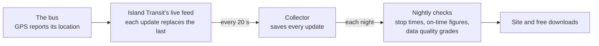

# Open Island Transit Data

[](https://github.com/dfladagermccullugh-bot/Open-Island-Transit-Data/actions/workflows/ci.yml)
[](https://github.com/dfladagermccullugh-bot/Open-Island-Transit-Data/actions/workflows/nightly.yml)
[](https://dfladagermccullugh-bot.github.io/Open-Island-Transit-Data/)

How on time are Island Transit's buses? Every few seconds, each bus on
Whidbey and Camano Islands in Washington reports where it is, and each
report vanishes as soon as the next one arrives. This project saves every
one of them, figures out how often each bus left its stops on time, and checks
how trustworthy the tracking data is. Everything is free to download.

You can see the results at
<https://dfladagermccullugh-bot.github.io/Open-Island-Transit-Data/>.

We have been collecting since November 19, 2026, every 20 seconds, around
the clock. The site's [Methods](https://dfladagermccullugh-bot.github.io/Open-Island-Transit-Data/methods.html) page gives the exact
definition behind every number, and its [Codebook](https://dfladagermccullugh-bot.github.io/Open-Island-Transit-Data/codebook.html)
describes every file.

## What you can find here

The site has four main pages. Routes shows a map of every route, colored by
how often its buses left on time, and lets you open any route to see the
stops where its buses fall behind. On time follows the whole system day by
day and hour by hour. Data quality asks whether the tracking data can be
trusted, showing how often it misses buses, drops out, goes stale, puts
buses off their route, or predicts arrivals wrongly. Download holds every
saved update and every table we build from them, one file per day. Once a
month is complete, it also gets a report and checksums you can use to check
your copies.

A departure counts as on time when the bus leaves from 1 minute early to
5 minutes late. We measure it at the stops printed in Island
Transit's timetables, because those are the times riders are promised. When
the tracking can't see a departure, we count it separately and never count
it as late.

## How it works



A small program, the collector, asks the feed for bus locations and arrival
predictions every 20 seconds, and for service alerts every 5 minutes. It saves exactly what comes back
and keeps a log of every request, and it runs on a free hosted database
(`supabase/`). Each night, the previous day's saved data goes to
[GitHub Releases](https://github.com/dfladagermccullugh-bot/Open-Island-Transit-Data/releases),
one file per day, with checksums.

The feed tells us where a bus is, but it never says when the bus left a
stop. So each night our script traces every bus along its route and figures
out when it passed each stop (`pipeline/events/`). The script checks that
work every day against the stop changes the feed itself reports, and we
also time buses in person on route 60 to compare.

Our scripts then grade the feed the way survey researchers grade any source
of data (`pipeline/quality/`). Coverage asks whether every scheduled trip
appears at all. Nonresponse looks for gaps and failed requests. Measurement
error covers GPS wobble, stale locations and wrong predictions. Processing
error catches IDs that don't match the schedule, and paradata is the log of
the collection itself. After each nightly run, the site rebuilds itself with
the new numbers (`site/`).

## Data

| Where | What |
|---|---|
| Releases `raw-YYYY-MM` | Every response from the feed, exactly as received; the request log; the schedule files |
| Releases `parsed-YYYY-MM` | Tables of bus locations, arrival predictions, alerts, and inferred stop arrivals and departures (Parquet) |
| [`data` branch](https://github.com/dfladagermccullugh-bot/Open-Island-Transit-Data/tree/data) | Daily quality and on-time figures (JSON and CSV), route maps, monthly reports, and manifests listing every file with its size and SHA-256 |

The [codebook](docs/codebook.md) describes every file and column, the
[methods](docs/methods.md) give the exact definition behind every number,
and the [decisions](docs/decisions.md) log records every design choice and
the reason for it.

## Use the data

The daily figures are small CSV files you can read straight from the `data`
branch. This reads the on-time table, one row per service day:

```python
import pandas as pd

base = "https://raw.githubusercontent.com/dfladagermccullugh-bot/Open-Island-Transit-Data/data"
ontime = pd.read_csv(f"{base}/ontime/daily.csv", parse_dates=["service_date"])
print(ontime[["service_date", "observed_share", "on_time_share_of_observed"]])
```

The larger tables are Parquet files in the monthly Releases, one per day.
This downloads the inferred stop times for one day and reads them:

```bash
curl -LO https://github.com/dfladagermccullugh-bot/Open-Island-Transit-Data/releases/download/parsed-2026-11/stop-events-2026-11-20.parquet
```

```python
events = pd.read_parquet("stop-events-2026-11-20.parquet")
print(events[events.is_timepoint].departure_status.value_counts())
```

`manifest/*.json` on the `data` branch lists every file with its size and
SHA-256, so you can check that a download is complete.

To see whether the collector is running right now, ask it for its status:

```bash
curl -s "https://ekczqlmunyumtgtthppb.supabase.co/rest/v1/status_now" \
  -H "apikey: sb_publishable_AWlvBYVrlTz7dEaf7RwwzA_5zRN3af-"
```

## Repository layout

| Path | Contents |
|---|---|
| `supabase/` | The collector: database tables, scheduler, public read-only views, and the collecting function |
| `pipeline/` | Archive, parsing, stop-time inference, quality metrics, monthly reports (Python) |
| `site/` | The public site (Quarto with Observable Plot and Leaflet) |
| `reference/` | Timepoints from Island Transit's printed timetables; field observations |
| `scripts/` | Health check, feed check, a local rehearsal of the nightly run, the site's build checks |
| `.github/workflows/` | The nightly archive, the site build, the watchdog and the tests |
| `constraints.txt` | The exact library versions every workflow installs, so a library update cannot change a figure unnoticed |
| `tests/` | Tests and fixtures |
| `docs/` | Methods, codebook, decisions, collector setup, field-check guide |

## Run the checks yourself

```bash
pip install -e ".[dev]" -c constraints.txt
ruff check . && ruff format --check .
pytest
python scripts/watchdog.py
python scripts/verify_feed.py
```

```bash
deno test --allow-read supabase/functions/collect/
```

The first three commands need no network. `watchdog.py` asks the live
collector whether it is healthy. Run `verify_feed.py` between about 6 AM and
7 PM Pacific, when buses are sure to be on the road for it to check (weekday
service itself runs from about 3:35 AM to 8:25 PM).

## How to cite

If you use the data or the figures, please credit them as "Open Island
Transit Data, derived from Island Transit's public GTFS feeds," with the
date you downloaded them. [`CITATION.cff`](CITATION.cff) has the same
information in a form reference managers can read. Corrections are welcome:
[`CONTRIBUTING.md`](CONTRIBUTING.md) explains how to report a wrong number
or ask for data to be removed.

## Licenses

The code is released under the MIT license ([`LICENSE`](LICENSE)). The data
terms are in [`LICENSE-DATA.md`](LICENSE-DATA.md): Island Transit published
no license for the source feeds, and the tables we derive from them are
CC BY 4.0. The map background on the site is © OpenStreetMap contributors.
The feeds describe vehicles only and contain no information about
individual riders.

This project is independent and has no connection to Island Transit or
Passio Technologies. Every number on the site comes from code in this
repository, run on Island Transit's public data.
