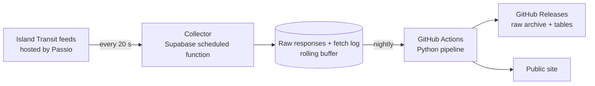

# Open Island Transit Data

A public archive of the real-time bus feeds published by Island Transit
(Whidbey and Camano Islands, Washington), with daily measurements of how good
that feed is as a source of data.

**Status: collecting since 2026-11-19, 1:24 PM Pacific.** Vehicle positions
and trip updates are fetched every 20 seconds, alerts every 5 minutes, and
the schedule twice a day. The nightly archive, the derived tables and the
public site are being built; until the archive is running, the data is
readable from the collector directly (below).

Live status of the collector:

```bash
curl -s "https://ekczqlmunyumtgtthppb.supabase.co/rest/v1/status_now" \
  -H "apikey: sb_publishable_AWlvBYVrlTz7dEaf7RwwzA_5zRN3af-"
```

## What this is

Island Transit publishes vehicle positions, arrival predictions and service
alerts as GTFS-Realtime feeds. It does not publish on-time performance data.

This project:

1. **Archives** every response from the three feeds, every 20 seconds, exactly
   as received.
2. **Measures the feed as a data-collection instrument**, using the error
   framework survey methodologists apply to any data source.
3. **Derives an on-time dataset** by inferring when buses actually reached
   their stops and comparing that with the schedule.
4. **Publishes everything**: raw responses, derived tables, code and methods.

| Survey idea | What is measured in the feed |
|---|---|
| Coverage | Share of scheduled trips that ever appear; routes and vehicles that never report |
| Nonresponse | Failed or empty fetches, stale data, gaps by hour and route, and whether gaps are random |
| Measurement error | GPS jitter, impossible jumps, stale positions, predicted versus actual arrival |
| Processing error | Real-time IDs that do not match the schedule; trips that cannot be assigned |
| Paradata | The fetch log itself: every request, its timing and its outcome |

Definitions are in [`docs/methods.md`](docs/methods.md).

## How it works



- **Collector** (`supabase/`): a scheduled function fetches each feed, stores
  the exact bytes with a SHA-256 hash, and logs the attempt whether it
  succeeded or not. It runs on a free hosted Postgres project. Anyone can
  read what it has stored; only the collector can write.
- **Pipeline** (`pipeline/`): Python code that turns raw responses into
  tables, infers stop arrivals and computes the quality metrics.
- **Raw data is the source of truth.** Every derived number can be rebuilt
  from the raw archive with the code in this repository.

## Repository layout

| Path | Contents |
|---|---|
| `supabase/migrations/` | Collector tables, scheduler, public read-only views |
| `supabase/functions/collect/` | The collector function and its tests |
| `pipeline/` | Parsing and analysis code (Python) |
| `scripts/verify_feed.py` | Feed check: fields, freshness, ID matching |
| `tests/` | Tests and fixtures |
| `docs/` | Methods, feed checks, decisions, collector setup |

## Run the checks yourself

```bash
pip install -e ".[dev]"
pytest
python scripts/verify_feed.py
```

```bash
deno test --allow-read supabase/functions/collect/
```

`verify_feed.py` needs to run during service hours (about 6 AM to 7 PM
Pacific) to see buses.

## Data and licenses

- Code: MIT ([`LICENSE`](LICENSE)).
- Data: see [`LICENSE-DATA.md`](LICENSE-DATA.md). No license was published for
  the source feeds; derived tables are CC BY 4.0.
- Vehicles only. The feeds contain no information about individual riders.

This project is independent and is not affiliated with Island Transit or
Passio Technologies.
