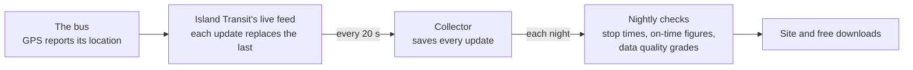

# Open Island Transit Data

**How on time are Island Transit's buses?** Island Transit (Whidbey and
Camano Islands, Washington) publishes where its buses are every few seconds,
but nobody keeps those updates. This project saves every one, works out how
often each bus left its stops on time, and checks how trustworthy the
tracking data is. Everything is free to download.

**Site: <https://dfladagermccullugh-bot.github.io/Open-Island-Transit-Data/>**

Collecting since November 19, 2026, every 20 seconds, around the clock.

## What you can find here

| | |
|---|---|
| **Routes** | A map of every route, colored by how often its buses left on time, and each route stop by stop: where buses fall behind. |
| **On time** | Day-by-day on-time figures for the whole system, every route and every hour. |
| **Can the data be trusted?** | How often the tracking misses buses, drops out, goes stale, puts buses off their route, or predicts arrivals wrongly. |
| **Download** | Every saved update and every derived table, one file per day, plus a monthly report with checksums. |

A departure is **on time** when the bus leaves between 1 minute early and 5
minutes late. It is measured at the stops printed in Island Transit's
timetables. Departures the tracking could not see are counted separately and
never counted as late.

## How it works



1. **Collect.** A small program asks the feed for bus locations, arrival
   predictions and alerts every 20 seconds and saves exactly what comes back,
   with a log of every request. It runs on a free hosted database
   (`supabase/`).
2. **Archive.** Each night, the previous day's saved data goes to
   [GitHub Releases](https://github.com/dfladagermccullugh-bot/Open-Island-Transit-Data/releases),
   one file per day, with checksums.
3. **Work out stop times.** The feed only says where a bus is, not when it
   left a stop. The saved locations are followed along each route to find
   when each bus passed each stop (`pipeline/events/`).
4. **Grade the data.** The feed is measured the way survey researchers grade
   any data source: coverage (do all trips appear?), nonresponse (gaps and
   failures), measurement error (GPS wobble, stale locations, wrong
   predictions), processing error (IDs that do not match the schedule) and
   paradata (the log of the collection itself) (`pipeline/quality/`).
5. **Publish.** The site is rebuilt after each nightly run (`site/`).

The method is checked every day against the feed's own stop changes, and in
person with timed observations on route 60.

## Data

| Where | What |
|---|---|
| Releases `raw-YYYY-MM` | Every response from the feed, exactly as received; the request log; the schedule files |
| Releases `parsed-YYYY-MM` | Tables of bus locations, arrival predictions, alerts, and inferred stop arrivals and departures (Parquet) |
| [`data` branch](https://github.com/dfladagermccullugh-bot/Open-Island-Transit-Data/tree/data) | Daily quality and on-time figures (JSON and CSV), route maps, monthly reports, and manifests listing every file with its size and SHA-256 |

Every field is described in the [codebook](docs/codebook.md); every
definition in [methods](docs/methods.md); every design choice and its reason
in [decisions](docs/decisions.md).

Live status of the collector:

```bash
curl -s "https://ekczqlmunyumtgtthppb.supabase.co/rest/v1/status_now" \
  -H "apikey: sb_publishable_AWlvBYVrlTz7dEaf7RwwzA_5zRN3af-"
```

## Repository layout

| Path | Contents |
|---|---|
| `supabase/` | The collector: database tables, scheduler, public read-only views, and the collecting function |
| `pipeline/` | Archive, parsing, stop-time inference, quality metrics, monthly reports (Python) |
| `site/` | The public site (Quarto with Observable Plot and Leaflet) |
| `reference/` | Timepoints from Island Transit's printed timetables; field observations |
| `scripts/` | Health check, feed check, a local rehearsal of the nightly run |
| `tests/` | Tests and fixtures |
| `docs/` | Methods, codebook, decisions, collector setup, field-check guide |

## Run the checks yourself

```bash
pip install -e ".[dev]"
pytest
python scripts/verify_feed.py
```

```bash
deno test --allow-read supabase/functions/collect/
```

`verify_feed.py` needs to run during service hours (about 6 AM to 7 PM
Pacific) to see buses.

## Licenses

- Code: MIT ([`LICENSE`](LICENSE)).
- Data: see [`LICENSE-DATA.md`](LICENSE-DATA.md). No license was published for
  the source feeds; derived tables are CC BY 4.0.
- Map background on the site: &copy; OpenStreetMap contributors.
- Vehicles only. The feeds contain no information about individual riders.

This project is independent and is not affiliated with Island Transit or
Passio Technologies. Every number on the site is computed by code in this
repository from Island Transit's public data.
